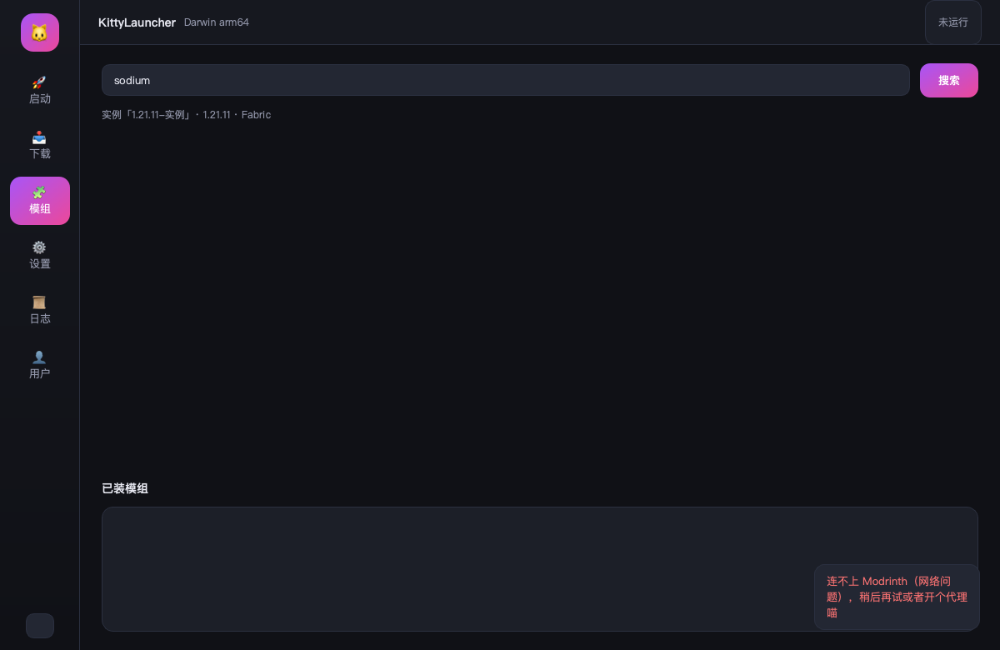

# KittyLauncher · 猫咪启动器

> **Mac 上没有 PCL？那就自己造一个。**
> 一个用 Python + Qt 写的 **macOS 专用** Minecraft 启动器：PCL 的操作手感、原生的窗口、MIT 开源。

---

## 为什么会有这个东西

Windows 玩家有 PCL2 —— 好用、顺手、免费。
Mac 玩家打开官网，看到一行小字：**只支持 Windows**。
然后在一堆 Java 套壳启动器里挑一个能用的，忍受 2013 年的界面和永远看不懂的报错。

KittyLauncher 就是来补这个洞的：
**把 PCL 那套"点两下就能玩"的体验，搬到 macOS 上，并且把源码摊开给你看。**

---

## 它长这样


左边六个入口，右边卡片式实例管理 —— 启动、下载、模组、设置、日志、用户。
紫粉渐变配色，深浅双主题，开关一按就换。

<table>
<tr>
<td></td>
<td></td>
</tr>
<tr>
<td></td>
<td></td>
</tr>
</table>

---

## 五个"别家没有"的细节

### 1. 启动只要 0.3 秒

不是夸张，是实测：`App()` 构造 0.31s（冷缓存），闪屏 0.96s 后主窗口就出来了。
皮肤、模组信息这类要联网的东西**全部丢后台线程**，界面永远不等网络。

### 2. 3D 皮肤预览，纯 Qt 手搓，没碰 OpenGL


把皮肤拆成 6 个长方体 → 顶点旋转 → 正交投影 → `QTransform.quadToQuad` 把贴图透视贴上去 → 画家算法排序。
**单帧 2ms**（72 个面）。拖拽旋转、滚轮缩放、双击暂停自转。
兼容 64×64 新皮肤、64×32 老皮肤、以及 Alex 那种 3px 手臂的纤细模型。

### 3. 崩溃日志会讲人话


点一下「分析日志」，15 条规则把天书翻译成中文：

> ❌ **内存不够** —— 游戏申请的内存超过了 -Xmx，常见于加了很多模组或开了高视距。
> 修法：把该实例的内存上限调到 4096~8192 MB；光影 + 大型整合包建议 8G 起。

内存不足 / Mixin 冲突 / 缺前置 / Java 版本不对 / 显卡驱动 / 版本文件损坏 / 权限问题……
连出错的那一行都会给你圈出来。

### 4. 出问题只要一条命令

```bash
./run.sh --env
```

Python、Qt、Java 版本、数据目录、磁盘剩余、账号状态、每项 ✅/⚠️/❌ —— 一行不缺。
玩家把这段贴进 issue，比描述一百句都管用。

### 5. 不借别人的客户端 ID

微软登录走**设备码流程**：点一下 → 浏览器输 8 位码 → 回来就登录好了。
但 Azure 的 `client_id` 要你自己注册（3 分钟，README 有步骤）——
**我们不塞一个来路不明的公共 ID 进去**，那东西被限流会连累所有人。

---

## 功能一览

| | |
|---|---|
| **版本** | 原版（正式版 / 快照全量）、Fabric、Forge、Quilt |
| **实例隔离** | 每个实例独立的 `mods / saves / config / 资源包`，公共库只存一份 |
| **账号** | 微软正版（设备码 + token 自动续期）、离线登录 |
| **皮肤** | 3D 可旋转预览、头像、按名字查别人、老皮肤 / slim 兼容 |
| **模组** | Modrinth 搜索、按当前版本 + 加载器过滤、一键装进实例 |
| **整合包** | `.mrpack` 拖进窗口就装成新实例；实例可导出 zip 发给朋友 |
| **设置** | 实例级内存 / JVM 参数 / 窗口 / Java 覆盖，全局兜底 |
| **网络** | 官方源 ↔ BMCLAPI 镜像一键切，下载卡 61% 时会自动超时重试 |
| **诊断** | 日志崩溃分析（15 条规则）、环境自检、启动器日志落盘 |
| **工程** | 深浅主题、启动闪屏、退出状态同步、依赖自检、issue 模板 |

---

## 跟同类比

| | KittyLauncher | PCL2 | HMCL | Prism |
|---|---|---|---|---|
| 原生 macOS 体验 | ✅ | ❌ | ⚠️ Java 套壳 | ⚠️ Qt |
| 界面语言 | Python + Qt | VB.NET | Java | C++ |
| 开源协议 | **MIT** | 闭源 | GPL-3 | GPL-3 |
| 3D 皮肤预览 | ✅ | ✅ | ✅ | ✅ |
| 安装体积 | ~115 MB 依赖 | ~40 MB | ~50 MB | ~200 MB |

不吹"最强"——**它只是把 PCL 的顺手劲儿搬到了 Mac 上，然后按 MIT 摊开。**

---

## 三行跑起来

```bash
git clone https://github.com/guofuxiuer-max/kitty-launcher.git
cd kitty-launcher && ./scripts/setup.sh     # 自动挑 Python 3.10+、装依赖
./run.sh                                    # 开玩
```

打成品包：

```bash
./scripts/build_app.sh     # → dist/KittyLauncher.app（图标已配好）
```

---

## 实测进度（不是 PPT）

| 步骤 | 结果 |
|---|---|
| 装原版 26.3 | 758 MB / 5149 个资源 / client jar 校验通过 |
| 启动原版 | `Setting user: Kitty` → `Backend library: LWJGL 3.4.3` → 窗口创建成功 |
| 装 Fabric | `fabric-loader-0.20.1-26.3`，88 条 classpath **0 缺失** |
| 装 Sodium | 启动日志确认 `- sodium 0.9.3-beta.1+mc26.3` 已加载 |
| 3D 皮肤 | 单帧 2ms，四角度渲染无拉伸 |
| 启动耗时 | App 构造 0.31s，闪屏 0.96s |

---

## 路线图

- [x] 版本隔离、多加载器、微软登录、3D 皮肤、整合包导入、日志诊断、镜像切换
- [ ] NeoForge / OptiFine 安装
- [ ] CurseForge 作为第二个模组源
- [ ] 多账号档案（正版 / 离线并存）
- [ ] 换肤（上传皮肤）
- [ ] 公证（notarization），双击不再被 Gatekeeper 拦

---

## 最后

如果你也曾经在 Mac 上打开过 PCL 的官网、看到「仅支持 Windows」然后叹了口气 ——
这个项目就是为你写的。

**Star 一下，或者直接提 issue 骂我哪里难用，都算帮忙喵～**

<sub>MIT License · 用的是 Mojang 官方下载源和自己的双手，没有一行代码来自 PCL</sub>
