# KittyLauncher · 猫咪启动器


> **我的世界启动器 · 我的世界mac · pclmac** —— macOS 专用的 PCL 风格 Minecraft 启动器（PCL-style launcher for macOS），Python + PySide6 写的原生桌面程序。
> 因为 PCL2 只跑在 Windows 上，Mac 用户一直缺一个长得像它、用起来也像它的启动器，所以有了这个。
> **只做 macOS** —— Windows / Linux 不做适配，也不接受相关 PR。

<sub>关键词：我的世界启动器 · 我的世界 mac 启动器 · pclmac · pcl for mac · PCL 替代品 · Minecraft launcher macOS · PCL-style launcher · Fabric / Forge / Quilt · Modrinth</sub>

## 项目状态（先看这里）

**0.9.0 beta，可以日常用，但别拿去装机房。**

| 项目 | 情况 |
|---|---|
| macOS 26 / Apple Silicon | ✅ 实测：装 26.3、Fabric、Sodium、启动进游戏、正版登录链路、3D 皮肤 |
| Windows / Linux | ❌ **不支持**，也不打算支持 |
| 自动化测试 | ❌ 只有 CI 里的冒烟（语法 + 引擎 + 无头渲染），没有单测 |
| 数据兼容性 | ⚠️ `instances.json` / `accounts.json` 格式在 1.0 前可能变 |
| 测试玩家 | 就作者一个喵 |

报 bug 请附 `./run.sh --env`，见「出问题怎么报 issue」。


## 演示视频

| 版本 | 尺寸 | 时长 | 文件 |
|---|---|---|---|
| 竖屏（抖音 / 小红书） | 1080×1920 | 47 秒 | [`docs/KittyLauncher-promo.mp4`](docs/KittyLauncher-promo.mp4) |
| 横屏（B 站 / YouTube） | 1920×1080 | 47 秒 | [`docs/KittyLauncher-promo-16x9.mp4`](docs/KittyLauncher-promo-16x9.mp4) |

[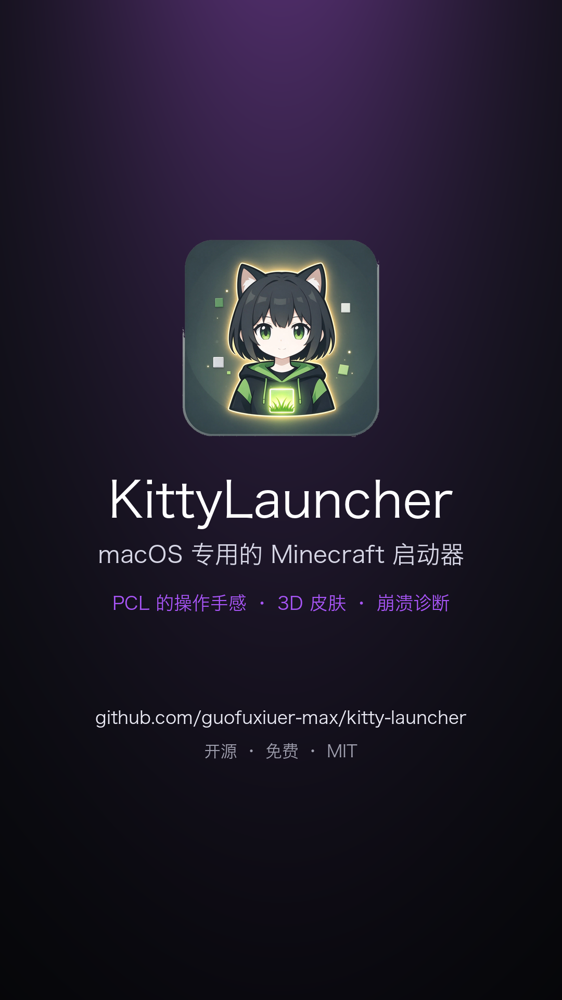](docs/KittyLauncher-promo-16x9.mp4)

- 旁白是**零样本音色克隆**（F5-TTS + 参考音色），不是机器播报腔
- 弹幕、字幕、纯音乐 BGM 全部代码生成，无版权风险
- 重新出片：`./.venv/bin/python tools/make_promo_video.py [--horizontal] [--stills]`

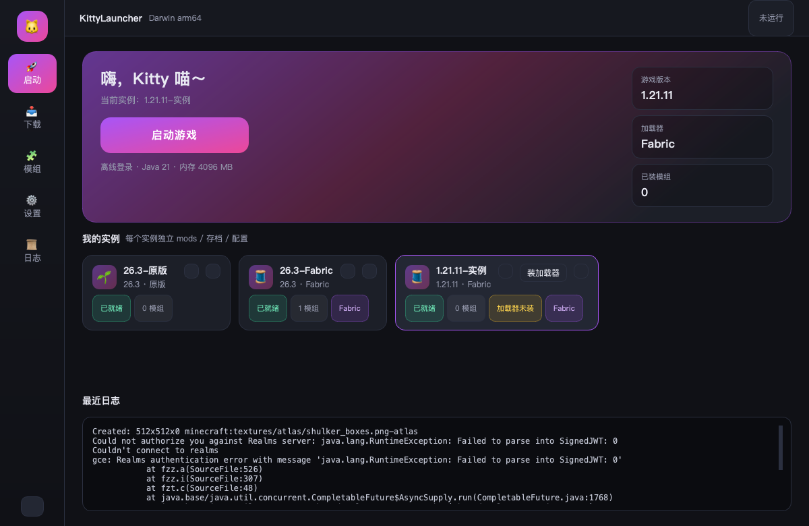

> 界面：左侧导航 **启动 / 下载 / 模组 / 设置 / 日志 / 用户**，实例卡片式管理，紫粉渐变 + 深浅双主题。

<details>
<summary>更多截图</summary>

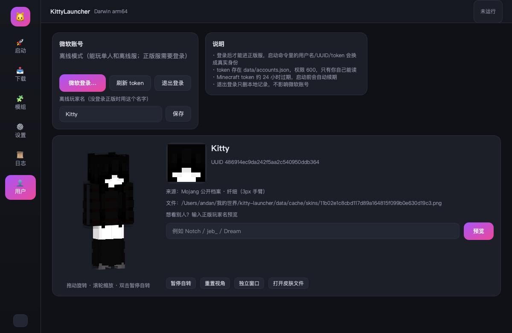
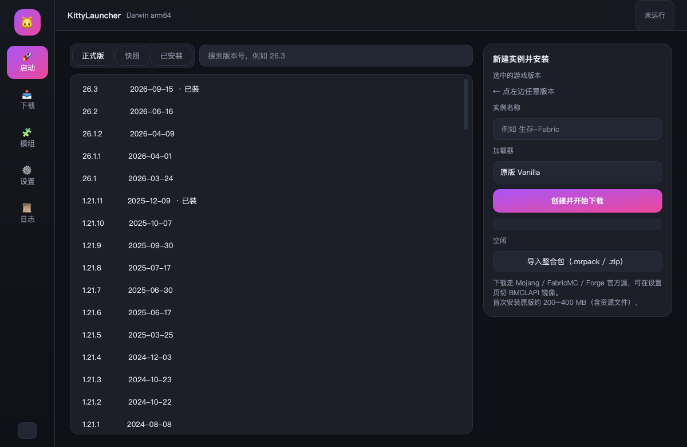
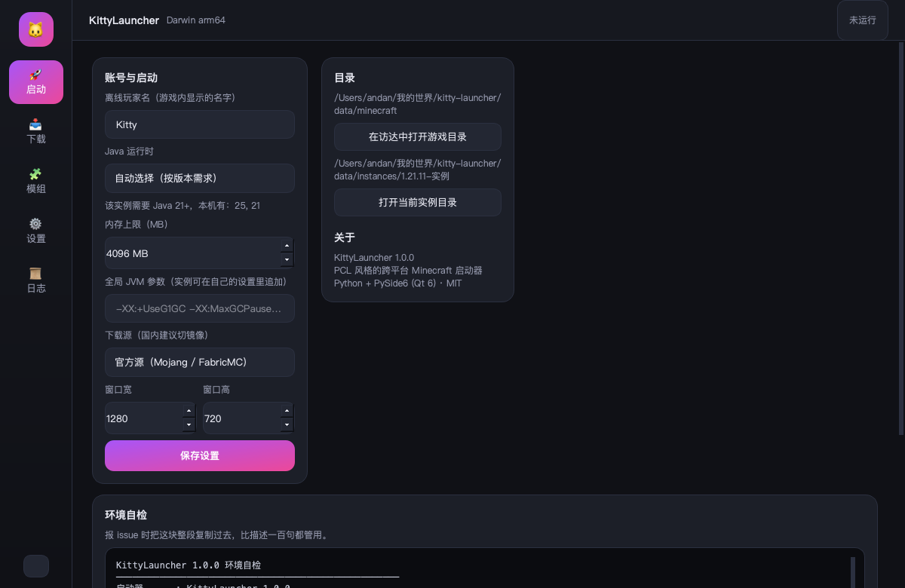
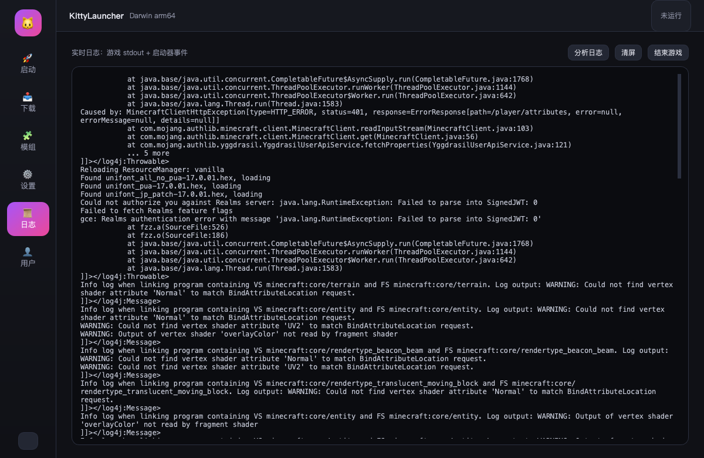

实例设置（PCL 的「版本设置」）：

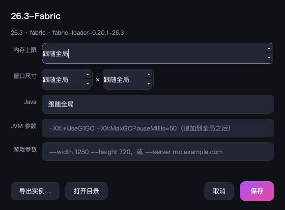

日志诊断（用一份故意写坏的日志演示）：

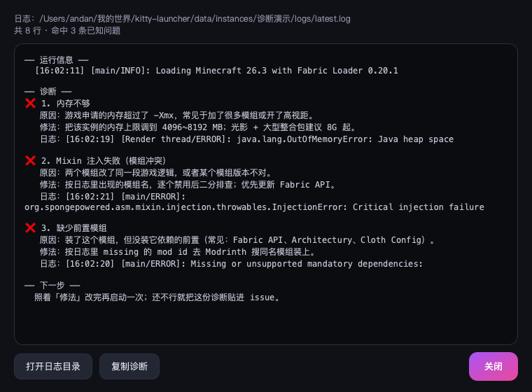

</details>

## 特性

- **版本隔离**：每个实例独立 `mods / saves / config / 资源包`，公共库和资源只存一份
- **一键装版本**：原版（正式版 / 快照全量列表）、Fabric、Forge、Quilt
- **微软正版登录**：设备码流程，浏览器输 8 位码即可；token 自动续期，可进正版服
- **离线登录**：不登录也能玩，填个名字就行
- **自动挑 Java**：扫本机所有 JDK，按目标版本要求选够用且最新的那个；版本不够会提示
- **模组市场**：内置 Modrinth 搜索，按当前实例的 MC 版本 + 加载器过滤，一键下载到 `mods/`
- **实时日志**：游戏 stdout 实时进日志页，同时落盘到 `data/logs/`
- **环境自检**：启动时打印一行摘要，设置页有完整报告可一键复制，`./run.sh --env` 直接在终端出结果
- **实例级设置**：每个实例单独设内存 / 窗口 / Java / JVM 参数 / 游戏参数，0 或空 = 跟随全局
- **整合包导入**：把 `.mrpack` 拖进窗口就装成新实例（Modrinth 整合包）
- **日志诊断**：一条命令把常见崩溃翻成中文，给原因 + 修法 + 出错行（内存不足 / Mixin 冲突 / 缺前置 / Java 版本 / 驱动…）
- **下载源切换**：官方源 ↔ BMCLAPI 镜像，国内网络一键加速
- **实例导出/导入**：打包成 zip 发给朋友，朋友导入即用
- **启动闪屏**：logo 淡入 + 进度条，主窗口在闪屏淡出后出现（可 `--no-splash` 关掉）
- **3D 皮肤预览**：拖动旋转 / 滚轮缩放 / 自动转圈，兼容 64×64 与老 64×32、经典与纤细(slim)模型
- **深浅双主题**：PCL 那套紫粉配色，一键切换

## 实测（不是 PPT，一条条跑过）

本机 macOS 26 / Apple M5 Pro / Java 25 实测：

| 步骤 | 结果 |
|---|---|
| 安装原版 26.3 | 758 MB / 5149 个资源文件 / client jar 按清单大小校验通过 |
| 启动原版 | `Setting user: Kitty` → `Backend library: LWJGL 3.4.3` → `Created window using SDL video driver: cocoa` |
| 装 Fabric | `fabric-loader-0.20.1-26.3`，88 条 classpath 全部命中，0 缺失 |
| 启动 Fabric | `Loading Minecraft 26.3 with Fabric Loader 0.20.1` |
| Modrinth 装 Sodium | `sodium-fabric-0.9.3-beta.1+mc26.3.jar`，启动日志确认 `- sodium 0.9.3-beta.1+mc26.3` 已加载 |

## 微软正版登录

PCL / HMCL 这类启动器都自带一个 Azure 应用 ID，**本项目不内置**（拿别人的 ID 属于滥用，
账号被限流会连累所有人）。所以要玩正版服，主人得花 3 分钟注册一个自己的：

1. 打开 [Azure 门户 → 应用注册](https://portal.azure.com/#view/Microsoft_AAD_RegisteredApps/ApplicationsListBlade)
   → 「新注册」
2. 名称随便填（例如 `KittyLauncher`），**受支持的账户类型**选
   「仅此组织目录中的账户」或「任何组织目录中的账户和个人 Microsoft 账户」都行
3. 注册完进 **身份验证（Authentication）** → 拉到底 → **允许公共客户端流** 选「是」→ 保存
4. 回到「概述」，复制 **应用程序(客户端) ID**（形如 `1234abcd-12ab-...`）
5. 启动器：**用户** 页 → 微软登录 → 粘贴这个 ID → **生成验证码**
6. 浏览器会打开 `microsoft.com/link`，输入那 8 位码，选自己的 Xbox 档案 → 启动器自动完成登录

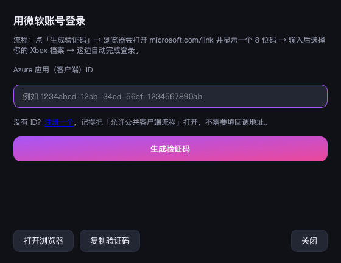

登录后：

- 启动命令里的 `--username / --uuid / --accessToken` 换成真实身份，能进正版服
- token 存在 `data/accounts.json`（权限 `600`，只有你自己能读），Minecraft token 约 24 小时过期，
  **启动前会自动用 refresh_token 续期**，失败会明确提示「请重新登录」
- 「退出登录」只删本地记录，不影响你的微软账号

## 启动闪屏

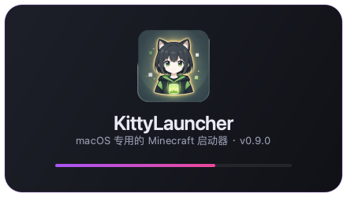

- 440×250 的圆角卡片，logo 淡入 220ms → 进度条 600ms → 淡出 240ms 交出主窗口
- **至少显示 720ms**，不会因为启动太快而闪一下
- 闪屏显示期间正好盖住 `App()` 初始化（读配置 / 扫 Java / 扫实例，约 0.3s）
- 皮肤查询**不阻塞启动**：先显示缓存或占位，后台线程拉到后再刷新（实测冷缓存 2.8s 内补上）
- `./run.sh --no-splash` 或 `KITTY_NO_SPLASH=1` 可跳过；截图模式自动跳过

## 用户页

左边导航最下面那个 **用户**，微软账号相关的东西全在这里：

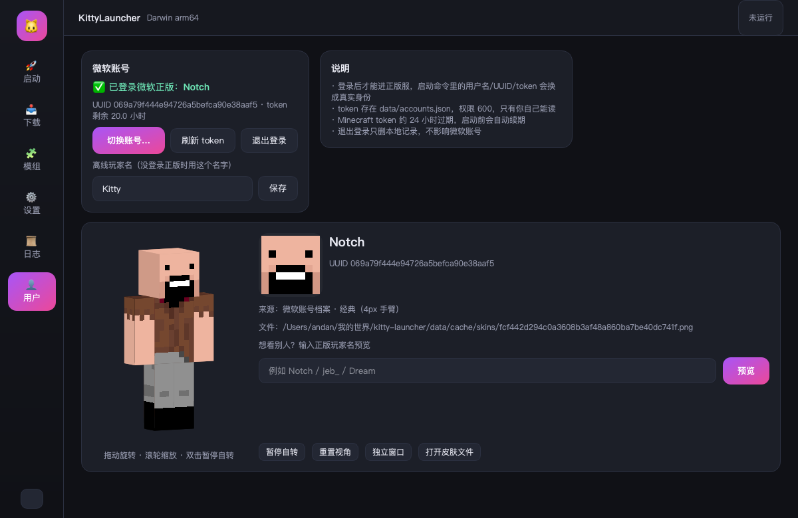

- 账号状态：离线 / 已登录（名字 + UUID + token 剩余时间）
- 三个按钮：**微软登录…** / **刷新 token** / **退出登录**
- 离线玩家名：不登录正版时用它，保存在配置里
- 下半部分就是 3D 皮肤预览，见下一节

## 3D 皮肤预览

在「用户」页里，左边是可以转的 3D 小人，右边是头像和档案：

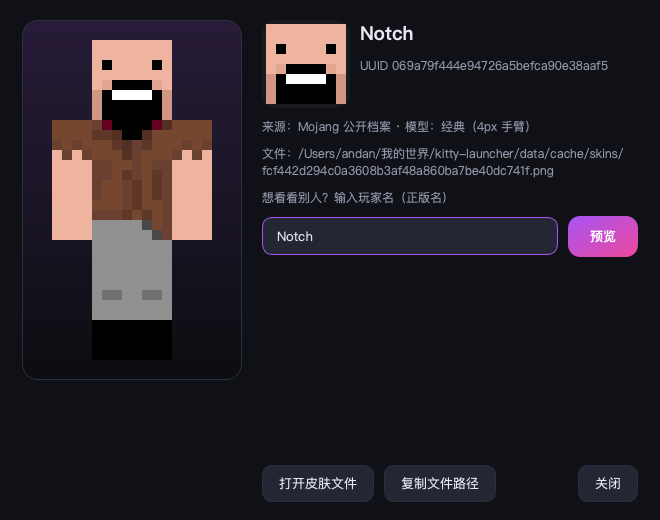

转一圈的样子（同一张皮肤，20° / 70° / 120° / 170°）：

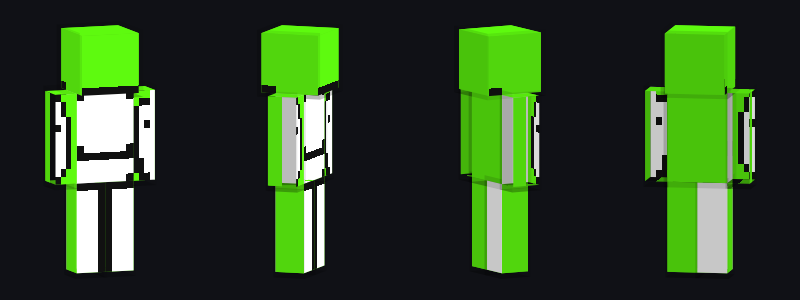

**没有用 OpenGL，也没有引第三方 3D 库**，纯 `QPainter` 手搓正交投影：

1. 皮肤拆成 6 个长方体部件：头 8×8×8、身 8×12×4、双臂/双腿各 4×12×4（slim 手臂 3×12×4）
2. 每个部件的 6 个面都有标准 UV（例如头正面 `(8,8,8,8)`、身体正面 `(20,20,8,12)`）
3. 顶点按 yaw/pitch 旋转 → 正交投影，得到屏幕上的四个点
4. `QTransform.quadToQuad(皮肤矩形, 投影四边形)` 把贴图**透视贴**到这个面上
5. 所有面按深度排序后依次绘制（画家算法），侧面/底面再加一点明暗，方块感更强

实测单帧渲染 **2 ms**（72 个面），自转 50ms 一帧完全无压力喵～

- 左边是按标准 UV 拼出来的**正面站姿**（头 8×8、身 8×12、四肢各 4×12），右边是头像 + 档案信息
- 取皮肤的顺序：**已登录微软账号档案里的 skins[].url** → 名字查 `api.mojang.com` 拿 uuid →
  `sessionserver.mojang.com` 取 textures → 都失败就画一张占位皮肤（界面永远不空）
- 兼容老皮肤：`64×32` 的 legacy 图没有左臂/左腿分层，渲染时用右臂/右腿顶替；帽子/外套/袖子/裤腿这些叠加层会按 1.12 倍外扩一起画
- 支持纤细模型（Alex）：手臂 3 宽并向内收 0.5，不是硬套 4 宽
- 皮肤缓存在 `data/cache/skins/`，24 小时过期；右下角能看到文件路径，可以复制或直接打开
- 顺手也能预览**别人**：输个正版名（例如 `Notch`）点「预览」就行


## 和 Windows 上的 PCL2 差在哪

PCL2 是 Windows 专用的闭源启动器，这里按功能逐条对照（✅ 有 / ⚠️ 部分 / ❌ 暂无）：

| 功能 | PCL2 | KittyLauncher |
|---|---|---|
| 版本隔离（每实例独立 mods/存档） | ✅ | ✅ |
| 原版 / 快照安装 | ✅ | ✅ |
| Fabric / Forge / Quilt | ✅ | ✅ |
| NeoForge | ✅ | ❌ |
| OptiFine 安装 | ✅ | ❌ |
| Modrinth 整合包导入（.mrpack） | ✅ | ✅ |
| CurseForge 整合包导入 | ✅ | ❌ |
| 实例导出 / 导入 | ✅ | ✅ |
| 离线登录 | ✅ | ✅ |
| 微软正版登录 | ✅ | ✅（设备码，需自备 Azure client_id） |
| 外置登录（authlib-injector） | ✅ | ❌ |
| Java 自动检测 | ✅ | ✅ |
| 自动下载 JRE | ✅ | ✅（Mojang 官方 JRE） |
| 内存 / JVM 参数 | ✅ | ✅（全局 + 实例覆盖） |
| 模组搜索安装 | ✅ | ✅（Modrinth） |
| CurseForge 模组源 | ✅ | ❌ |
| 日志 / 崩溃分析 | ✅ | ✅（内置规则库） |
| 下载源镜像 | ✅ | ✅（BMCLAPI） |
| 多账号档案 | ✅ | ❌（当前单账号） |
| 皮肤预览 / 换肤 | ✅ | ⚠️ 3D 预览 ✅ / 换肤 ❌ |
| 联机（NAT 穿透） | ✅ | ❌ |
| 多语言（中/英切换） | ✅ | ❌ |
| 自动更新 | ✅ | ❌ |
| 平台 | Windows 独占 | **仅 macOS** |
| 开源 | ❌ | ✅ MIT |

## setup.sh 到底下载什么？

一句话：**只装 Python 那一侧的库，不碰 Java，也不碰 Minecraft 本体。**

| 东西 | setup.sh 会下吗 | 体积 | 什么时候用到 |
|---|---|---|---|
| PySide6-Essentials + shiboken6 | ✅ 会 | 下载 ~106 MB，展开 ~348 MB | 界面 |
| minecraft-launcher-lib + requests（含 urllib3 / certifi / idna / charset-normalizer） | ✅ 会 | ~1 MB | 下载、安装、启动 |
| Python 解释器本身 | ❌ 不下 | — | 需要机器上已有 3.10+；一个都没有时会问你要不要用 brew 装 |
| **Java** | ❌ 不下 | 每个组件约 100 MB | 装游戏版本时启动器**自动**下 Mojang 官方 JRE 到 `data/minecraft/runtime/` |
| **Minecraft 本体 + 资源** | ❌ 不下 | 26.3 约 700 MB | 在「下载」页建实例时才下 |

一个「什么都没有」的干净机器，从零到能玩：

```
setup.sh（Python 库）     ~115 MB 下载 / ~365 MB 磁盘
第一次装 26.3（含 JRE）    ~700 MB 下载 / ~1.0 GB 磁盘
```

**玩家不需要自己装 Java**：只要装过任意一个版本，`data/minecraft/runtime/` 里就有一份能用的 JRE，
环境自检里显示成 `Java 25 · Mojang 自带`，启动时也会自动挑它。

## 快速开始

### 方式一：直接跑源码（推荐开发者）

```bash
git clone https://github.com/guofuxiuer-max/kitty-launcher.git
cd kitty-launcher

python3 -m venv .venv
./.venv/bin/pip install -r requirements.txt
./.venv/bin/python -m kitty.main
```

国内网络加个镜像更快：

```bash
pip install -r requirements.txt -i https://pypi.tuna.tsinghua.edu.cn/simple
```

### 方式二：用脚本（懒人版）

```bash
./scripts/setup.sh     # 自动挑 Python 3.10+、建 .venv、装依赖
./run.sh               # 启动
```

`setup.sh` 会依次尝试 `python3.14/3.13/3.12/3.11/3.10`、Homebrew 路径、
以及系统 `python3`，**只挑 >= 3.10 的**；如果挑到的解释器没带 `ensurepip`
（部分精简版 Python 会这样），它会从镜像直接把 pip 的 wheel 解压进 venv 兜底，不依赖系统 pip。

### 方式三：自己打包成 app

```bash
./scripts/build_app.sh          # 需要 pyinstaller，输出 dist/KittyLauncher.app
```

产物是 `dist/KittyLauncher.app`，双击即开（首次可能要在「系统设置 → 隐私与安全性」里放行）。

## 目录结构

```
kitty-launcher/
├── kitty/
│   ├── core.py        # 引擎：Java 探测 / 实例 / 安装 / 启动 / 模组（无 Qt 依赖，可单独用）
│   ├── pages.py       # 五个页面
│   ├── widgets.py     # 卡片、导航、标签等小组件
│   ├── theme.py       # 配色 + QSS
│   └── main.py        # 主窗口与入口
├── scripts/
│   ├── setup.sh
│   ├── build_app.sh
│   └── screenshot.sh  # 无头渲染截图，用于 README / 回归
├── data/              # 运行期数据（已 gitignore）
│   ├── minecraft/     # 公共版本库：versions / libraries / assets
│   ├── instances/     # 每个实例的游戏目录
│   └── logs/
├── requirements.txt
└── kitty_launcher.spec
```

数据目录规则：源码运行时在仓库 `data/`；打包成 app 后落到
`~/Library/Application Support/KittyLauncher`。
想强制指定：`export KITTY_DATA=/some/dir`。

## 它是怎么工作的（三层）

1. **`core.py`** —— 真正干活的层
   - `remote_versions()` 拉 Mojang 版本清单
   - `install_vanilla_job()` / `install_loader_job()` 起后台线程下载，进度通过 `current_job()` 轮询
   - `launch()` 拼启动命令 → `Popen` → 后台线程把 stdout 灌进日志缓冲
2. **`pages.py`** —— 只做展示与收集输入，所有耗时操作都丢给 `core` 的线程
3. **`main.py`** —— 窗口壳 + 两个 QTimer（1200ms 轮询任务、900ms 拉日志），所以 UI 永不卡死

底层下载/规则过滤/参数拼装交给 [`minecraft-launcher-lib`](https://github.com/JakobDev/minecraft-launcher-lib)（BSD-2-Clause），
它已经踩平了 macOS ARM64 原生库、legacy 版本参数、natives 解压这些坑。

## 路线图

已完成：

- [x] 实例内存 / JVM 参数 / 窗口 / Java 单独覆盖
- [x] Modrinth 整合包导入（`.mrpack`，可拖拽）
- [x] 日志崩溃诊断（15 条规则）
- [x] 下载源切换（BMCLAPI）
- [x] 实例导出 / 导入（zip）
- [x] 微软正版登录（设备码 + 自动续期）
- [x] 皮肤预览（3D 可旋转，老皮肤 / slim 兼容）

接下来（按优先级）：

- [ ] NeoForge / OptiFine 安装
- [ ] CurseForge 作为第二个模组源
- [ ] 多账号档案（正版 / 离线 / 外置登录并存）
- [ ] 换肤（上传皮肤需要正版 API，Mojang 官方换肤接口要鉴权）
- [ ] 自动更新（检查 GitHub Release）
- [ ] 多语言（中 / 英）
- [ ] 公证（notarization），双击不再被 Gatekeeper 拦

## 命令行参数

```bash
./run.sh                      # 启动图形界面（带闪屏）
./run.sh --no-splash          # 跳过闪屏
./run.sh --env                # 环境自检（Python / Qt / Java / 目录 / 权限），贴 issue 用
./run.sh --screenshot out/    # 无头渲染五个页面截图
./run.sh --help               # 帮助
```

启动时终端也会打印完整自检报告，日志页留一行摘要（`[环境] Python 3.12.14 · PySide6 6.12.0 · Java≤25 · 实例 2 · ✅ 正常`）。

## 出问题怎么报 issue

1. 跑 `./run.sh --env`，复制整段输出（或打开启动器 → 设置 → 环境自检 → 复制）
2. 启动器「日志」页最后 50 行，或 `data/logs/` 里最新的日志文件
3. 按 [Bug 模板](.github/ISSUE_TEMPLATE/bug_report.yml) 提 issue

自检会告诉你卡在哪一层：Python 版本 / Qt / 启动器底层 / Java / 数据目录权限，基本一眼定位。

## 常见报错

**`Could not find a version that satisfies the requirement minecraft-launcher-lib>=8.0`**

Python 太老。这个库 7.0 起就要求 `>= 3.10`，而 macOS 自带的是 3.9。
`setup.sh` 现在会自动挑 3.10+ 的解释器；如果你的机器上一个都没有：

```bash
brew install python@3.13     # 或者去 python.org 下安装包
./scripts/setup.sh           # 重跑（会重建 .venv）
```

**`ERROR: Command '.../python -m ensurepip' returned non-zero`**

同样的根因：解释器没带 ensurepip。新版 `setup.sh` 会用 `--without-pip`
建 venv，再手动补 pip，不会卡在这一步。

**`ModuleNotFoundError: No module named 'minecraft_launcher_lib'`**

`.venv` 装到了错误的 Python 里。删掉重来：`rm -rf .venv && ./scripts/setup.sh`。

## 已知限制

- **只支持 macOS**：Windows / Linux 不维护（不是暂不支持，是不做）
- 单账号：还不支持正版 / 离线多档案并存
- 没有自动更新：升级靠 `git pull`
- OptiFine / NeoForge 还没做
- 首次装原版要下 700 MB 左右，网络差会慢；设置里切 BMCLAPI 会快不少
- Forge 安装依赖官方 installer，首次较慢

## 发布到 GitHub（提交前清单）

```bash
# 1) 确认没有把游戏文件 / 依赖 / 账号文件带上去
git status --short
git ls-files | grep -E "data/|vendor/|\.venv/|accounts\.json" && echo "⚠️ 有不该提交的东西"

# 2) 打标签（0.9.0 = beta；自动化测试补齐后再发 1.0.0）
git tag -a v0.9.0 -m "KittyLauncher 0.9.0 beta"
git push -u origin main --tags
```

仓库设置里建议勾上：

- Topics：`minecraft-launcher` `pyside6` `qt` `python` `macos` `modrinth` `fabric`
- About 一句话：`macOS 专用的 PCL 风格 Minecraft 启动器 · Python + PySide6 · MIT`
- 开 Issues / PR / Discussions

## 发布到 GitHub

```bash
# 仓库已经初始化并提交过一次，直接改 remote 推上去
git remote add origin git@github.com:guofuxiuer-max/kitty-launcher.git
git branch -M main
git push -u origin main
```

如果从零开始：

```bash
git init
git add .
git commit -m "feat: macOS 专用的 PCL 风格 Minecraft 启动器"
git remote add origin git@github.com:guofuxiuer-max/kitty-launcher.git
git push -u origin main
```

仓库地址：`https://github.com/guofuxiuer-max/kitty-launcher`；截图在 `screenshots/`，
重新生成用 `./scripts/screenshot.sh`（无头渲染，不弹窗）。

## 许可证

[MIT](LICENSE)。用的第三方库：PySide6（LGPLv3）、minecraft-launcher-lib（BSD-2-Clause）、requests（Apache-2.0）。

## 致谢

- [PCL2](https://github.com/Meloong-Git/PCL) —— 界面与交互的灵感来源（本项目为独立实现，未使用其代码）
- [minecraft-launcher-lib](https://github.com/JakobDev/minecraft-launcher-lib) —— 启动器底层
- [Modrinth](https://modrinth.com) —— 模组搜索 API
